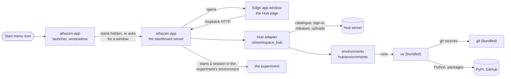
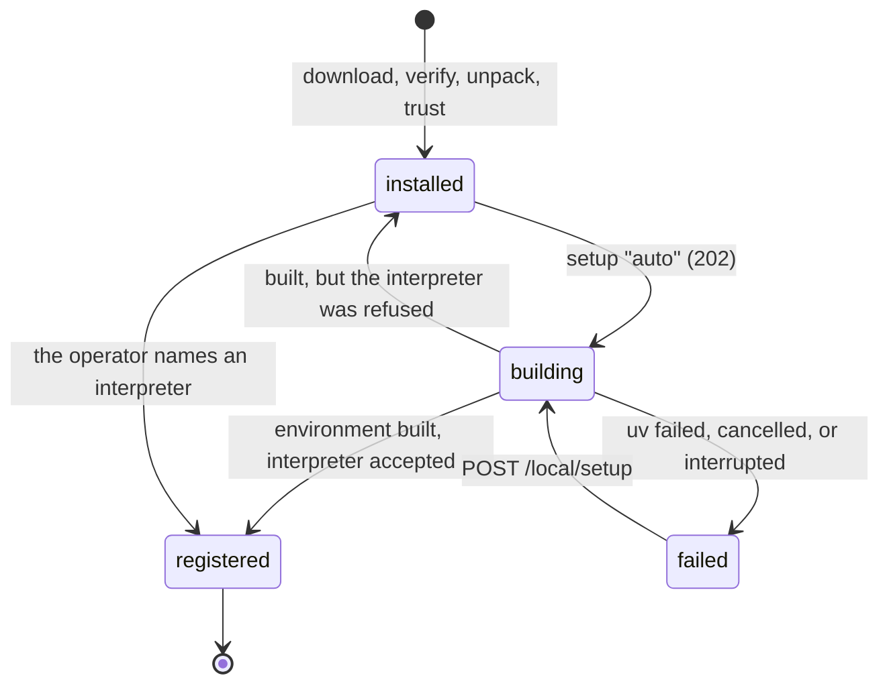

# The Alhazen app (Windows)

Status: development branch, built on the Experiment Hub branch. Windows only so far. Nothing here
changes `alhazen dashboard` or a local run.

## What it is for

Before the app, a rig needed three things done by hand before the Hub was any help: Python and
alhazen installed from a command line, a Python environment built for each experiment, and the
dashboard started from a terminal. The app replaces them:

1. Run one installer. It asks for no administrator rights.
2. Click the Alhazen icon. The Hub page opens in a window of its own.
3. Sign in, find an experiment in the marketplace or your library, and click **Install**.
4. The rig downloads the experiment, builds its Python environment from the versions its author
   locked, and registers it. **Open it in the workspace** runs it.

The app is the same alhazen and the same pages as `alhazen dashboard --hub`. It adds what goes
around them: an installer, a window, and automatic setup of an experiment.

## The parts



| Part | Secret it hides | Price |
|---|---|---|
| `packaging/windows` (installer) | what is copied to the computer, which uv and git are bundled and how they are verified, how the app's own Python is made | needs an internet connection during installation; the installer is unsigned |
| `alhazen.cli.app` (launcher and window) | which browser draws the window, how a closed window is noticed, what the app does then, how a second click finds the running app | the window is Microsoft Edge's |
| `alhazen.hub.environments` | how uv and git are found, which Python and extras an experiment gets, the exact command, where environments live | one environment per release; a release must ship its `uv.lock` |
| `alhazen.cli.workspace_hub` (setup routes) | that a setup runs in the background, one at a time, and how its state is recorded | a session cannot start while a setup runs |

## Installing the app

`AlhazenSetup-<version>.exe` is built by `packaging/windows/build.py` and Inno Setup. It installs
for the current user, into a fixed folder:

```
%LOCALAPPDATA%\Alhazen\
  app\            the app's own Python environment (made during installation)
  tools\uv.exe    uv, which builds Python environments
  tools\git\      MinGit, which uv needs for packages taken from a git repository
  wheels\         the alhazen wheel that was installed into app\
  install.log     the output of the installation's Python step
```

The installer copies the files, then has the bundled uv download Python 3.12 and install alhazen
and its packages into `app\`. That step needs an internet connection and downloads about 130 MB.
If it fails, the installer says so and names `install.log`; running it again repeats the step.

The Start-menu shortcut runs `app\Scripts\alhazen-app.exe`. An upgrade is the newer installer run
over the old one, with the app closed. An uninstall removes the folder; it leaves the person's
workspace (`%USERPROFILE%\.alhazen`: experiments, data, settings) and uv's shared download cache.

**Unsigned installer.** Windows SmartScreen shows "Windows protected your PC" for an installer
that is not signed with a code-signing certificate; the person has to choose *More info*, then
*Run anyway*. Signing needs a certificate bought by the project's owner.

## Starting and quitting

```mermaid
sequenceDiagram
  actor P as Person
  participant L as alhazen-app (launcher)
  participant S as alhazen app (server)
  participant E as Edge app window
  P->>L: click the icon
  L->>S: start, hidden (output to app.log)
  S->>E: open the Hub page
  S-->>L: answers on loopback
  Note over L: exits; a failure is shown in a message box
  P->>L: click the icon again
  L->>S: POST /api/app/window
  S->>E: open another window
  P->>E: close the last window
  Note over S: waits for a running session or setup, then stops
```

- **Closing the window quits the app.** The server stops once every app window is closed and no
  session or setup is running. A session or a setup is never cut short by closing the window:
  the server stays up, hidden, until it is done, and the next click on the icon finds it.
- **A second click** while the app runs opens another window on the same server. Two clicks in a
  row start one server: the launcher that is starting it holds a lock, the other one waits.
- **The workspace is the one `alhazen dashboard` uses** (`%USERPROFILE%\.alhazen\dashboard`), so
  experiments registered either way show up in both. If a dashboard started from a terminal
  already has it open, the icon opens that dashboard's page in the default browser.
- **Without Microsoft Edge** the page opens in the default browser and a small dialog stands in
  for the window: clicking OK quits the app.
- **The server's output** goes to `app.log` in the workspace folder, because the server has no
  visible console. A start that fails shows the end of that log.

Three choices that are not obvious, each measured on Windows 11 before it was written:

| Choice | Why |
|---|---|
| The server is a console program started hidden, not a windowless one | A session is a console program that the dashboard stops with a console break. Children of a hidden-console process inherit a console without a window: no console window appears for a run, and the break still reaches it. |
| "A window is open" means "an Edge process this server started is alive" | Edge is started on a profile folder of its own (`<workspace>\window`). The first process on a profile lives as long as one of its windows; a later one hands its window over and exits. |
| Edge gets `--disable-sync` and `msImplicitSignin` off | On a new profile Edge otherwise opened a sync confirmation in a second window, which would also have kept the app alive after its own window was closed. |

## Setting an experiment up

On the install panel, **Set it up for me** is the default wherever the rig has uv. The other
choice, **Use a Python I already prepared**, is the earlier behaviour and is unchanged.



What the rig decides from the release's own files (`alhazen.hub.environments.read_plan`):

| Decision | Rule |
|---|---|
| Python version | the release's `.python-version`; without one, the manifest's oldest supported Python |
| Extras | `rig` if the project defines it, otherwise `psychopy` if it defines that, otherwise none |
| Versions of every package | exactly the release's `uv.lock` (`uv sync --frozen`); nothing is resolved again on the rig |
| Where it goes | `<workspace>\hub\envs\<sha12>`, outside the release folder; the build's output is in `<sha12>.log` beside it |

The experiment itself is installed into the environment as an editable package. That is what
registers its tasks, while its code keeps being imported from the release folder. The build
backend may leave its metadata folder (`src\<name>.egg-info`) in the release folder; it is not one
of the release's declared files and no check counts it.

Rules the rig enforces:

- A setup starts only for a release the operator has trusted. Building runs the experiment's
  build backend, so it is "running the release's code" as much as a launch is.
- One setup at a time, none while a session runs, and no session starts while one runs: a build
  is hundreds of megabytes of disk and network.
- Every way out leaves a record that says what happened. A build that failed keeps the end of
  uv's output; one cut short by closing the app or by a crash is marked so at the next start.

### Routes

| Route | Meaning |
|---|---|
| `POST /local/install` with `setup: "auto"` (no `python`) | install, then build the environment in the background. 202 while it is being built; 201 when the release was already set up. |
| `POST /local/setup {sha256}` | build (again) the environment of a release already installed and trusted here. 202, or 200 when there was nothing to do. |
| `GET /local/status` | adds `setup: {available, reason, git}` and, on each install, `environment: {state, python_version, extras, git_packages, started_at, finished_at, detail}`. `detail` is uv's latest line while `state` is `building`. |
| `POST /api/app/window` | (the dashboard's own API) the running app shows its window; 409 on a dashboard that is not the app. |

Refusals, each with what to do in its message:

| Code | When |
|---|---|
| `setup_unavailable` | the computer has no uv, or the release has no `uv.lock` or `pyproject.toml` |
| `git_missing` | the lock file takes a package from git and the computer has no git |
| `setup_busy` | another setup is running |
| `setup_failed` | uv ran and reported an error (the end of its output follows) |
| `setup_cancelled`, `setup_interrupted` | the app was closed, or stopped, before the build finished |

## Making an experiment the app can set up

A release needs three ordinary files: `pyproject.toml`, `uv.lock` and, preferably,
`.python-version`. `alhazen hub pack` and the dashboard's package screen include them, and say so
when `uv.lock` is missing.

alhazen is not on PyPI, so `uv lock` needs to be told where it comes from. In the experiment's
`pyproject.toml`:

```toml
[tool.uv.sources]
alhazen-vision = { git = "https://github.com/sh4r11f/alhazen", tag = "v2.15.0" }
```

An experiment made with `alhazen new` does not have this entry yet; add it, then run `uv lock`.
Hardware packages that come from a vendor's own installer (VPixx, EyeLink) cannot be in a lock
file and are still installed by hand into the experiment's environment.

## Windows: how long an environment's paths may be

An environment's files start with `<workspace>\hub\envs\<sha12>\Lib\site-packages\`. The longest
path inside a PsychoPy environment measured 120 characters after that. With the default workspace
the longest full path is `190 + len(user name)` characters, under Windows' limit of 259 for user
names up to 69 characters. The installed app itself has shorter paths than that.

## What was verified

On a Windows 11 PC with long paths off and no symlink privilege:

- A real experiment (kde-vergence 0.5.0): its environment built from its own lock file with
  alhazen 2.15.0 from the git tag and PsychoPy; its three tasks registered; its code imported from
  the release folder.
- The app, started from the launcher: two clicks at once gave one server and one window in 6.5 s;
  a later click added a window in 2 s; closing the last window stopped the server and freed the
  workspace.
- The installer's layout and its two uv commands, run by hand, then
  `packaging/windows/smoke_test.py` from the installed Python: the app's own uv and git, with
  neither on PATH, built an environment for an experiment that takes alhazen from git.
- `tests/hub/test_live_roundtrip.py` (opt-in, `ALHAZEN_TEST_REAL_UV=1`): a real Hub server and a
  real rig; the rig built the environment itself and ran a session in it.

On GitHub's Windows runner (`.github/workflows/windows-app.yml`): the installer compiles; a
silent install, the smoke test, the end-to-end test above, an install over an install, and an
uninstall.

## Not verified, and not built

- **Nobody has clicked through the installer's pages or the app window by hand.** The window was
  opened and closed by a script; the pages were tested in the fake browser the other page tests
  use.
- **A session with a real PsychoPy window, started from the app**, and any session with real
  devices. The hidden-console design was measured with a stand-in child, not with a session.
- **A first build on a slow connection.** PsychoPy's environment is about a gigabyte; the builds
  here came from a warm cache.
- **Updates.** The app does not update itself; a newer installer is run over the old one.
- **A built-in Hub address.** The app starts at the Hub page and still asks for the server's
  address once, because no server is hosted yet.
- **Rigs listed in the account** ("My rigs"), experiment forks, and macOS or Linux installers.
- **Feedback while starting.** A cold start takes several seconds with nothing on screen.

## Building the installer

```
python -m build --wheel
python packaging/windows/build.py --wheel dist/alhazen_vision-<version>-py3-none-any.whl
```

`build.py` downloads uv and MinGit from their publishers' release pages and refuses either unless
it matches the SHA-256 written in the script (`PINNED`). To move to a newer one, change its
version, address and hash together, taking the hash from the publisher, and let the workflow build
and test the result. The compile step needs Inno Setup 6; `--stage-only` stops before it.
