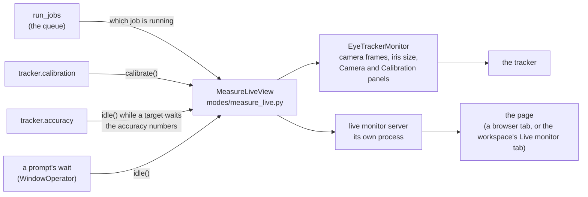

# Measure rig: what each measurement can claim

`--mode measure` checks what a rig claims about itself. Choose the
measurements (`--measure KEY`, repeatable, or the checkboxes the experiment
workspace shows for Measure rig); they run one after another in a fixed order
and write **one** report beside the rig file:
`<rig dir>/measurements/<rig>_<YYYYmmddTHHMMSS>.json`, never over an earlier one.

```text
python run.py --task <any task> --mode measure --rig lab \
    --measure monitor.refresh --measure monitor.geometry \
    --measure-input monitor.geometry.distance_cm=57.2
alhazen run --mode measure --list-measurements        # the catalog, as JSON
```

Without `--measure`, measure mode runs its original fixed list (display,
geometry, keys, tracker, ruler) exactly as before, with `--skip` and `--presses`.

## States

| State | Meaning |
|---|---|
| passed / failed | a measurement with a right answer, and whether the rig gave it |
| measured | a fact about the rig with no right answer (a latency distribution, a gamma fit) |
| unavailable | could not be measured on this rig, with the reason (no device, a stand-in, no driver, acquisition not running, recording unreadable) |
| cancelled | the operator stopped it at a prompt, declined to arm, or the run was stopped |
| blocked | its prerequisite in the same run produced no result |
| error | it raised; the message is the result |

Only passed and measured are results. The command exits 0 only when every
selected measurement produced one and none failed.

## The measurements

| Key | What is measured | Units | What it cannot claim |
|---|---|---|---|
| `monitor.refresh` | flip-to-flip intervals on the real window: rate against the rig file, late frames (FrameMonitor's rule) | Hz, s | photon timing: that needs a photodiode |
| `monitor.geometry` | eye-to-screen distance by tape; a 10° ruler bar's length by tape; px/deg declared vs measured | cm, px/deg | — the rig file is never changed; edit it if they disagree |
| `monitor.luminance` | photometer readings of grey levels (typed at the rig, or `readings=<csv>` level,luminance). At the rig each level fills the screen with nothing written on it and stays until SPACE; the reading is typed after. Gamma fit (`config.gamma.fit_gamma`) | cd/m² as entered | digital values are not luminance: without readings nothing is measured. **Never applied**: run `alhazen calibrate gamma --rig ... --measurements <the CSV it wrote>` to apply, keeping the old `_gamma.yaml` to roll back |
| `monitor.colour` | — | — | always unavailable: no colorimeter integration and no xyY model |
| `input.keys` | poll lag (software only) and flip-to-key time (panel + person + input path), kept apart | s | a single "key latency": end-to-end device latency needs loopback hardware |
| `input.mouse` | pointer travel per cm the mouse moves on the desk, slow and fast passes over a known distance. The distance is measured with a real ruler laid beside the mouse; nothing is drawn on the screen for it | px/cm | sensor DPI (needs raw counts); a fast/slow ratio ≠ 1 shows OS acceleration |
| `reward.connection` | read only: NI-DAQmx driver version, device present, its analog-output channel present | — | whether the valve opens or how much flows |
| `reward.volume` | the trains the operator chose (count, pulses per train, width, gap; the rig's line and voltage) after explicit arming (Y at the rig; never from `--measure-input`), then the volume read off the beaker; stored as the rig's reward calibration for that width (`rig-<name>.reward.yaml` beside the rig file, earlier measurements kept) | µL/pulse, µL/ms | volume from command duration, or for any width, line or voltage it was not measured at; a failed train stops the run, is reported failed, records nothing and is **never retried** |
| `neural.stream` | read only, bounded (default 2 s): SpikeGLX version, acquisition running, stream rate (reported vs observed), AP/LF/SY channel counts, RMS of up to 16 AP channels; or a sorted stream's announcements (check-rig's listen) | Hz, int16 ADC counts | µV (needs the probe gain), raw samples from a sorted stream; never starts/stops/reconfigures acquisition. Open Ephys is not supported: unavailable until `devices.spikes` names SpikeGLX |
| `tracker.calibration` | the tracker's own calibration procedure and verdict | — | anything for a stand-in (unavailable) |
| `tracker.accuracy` | fresh fixations on 5 targets after the calibration: bias, accuracy, precision (RMS sample-to-sample, as polled), dispersion (SD), gain (slope of gaze vs target) | degrees | device-rate precision (needs the native recording); runs only after `tracker.calibration` in the same run |

Experiment packages add measurements through the `alhazen.measurements`
entry-point group (kde-vergence adds `kde.bead`).

Measurements of the person or animal in the chair (`tracker.calibration`,
`tracker.accuracy`, `kde.bead`) need `--sub`; the subject is recorded only in
the measurement report. `input.keys` takes one if given. No participant record
is written.

## The live monitor during tracker measurements

A run that includes a measurement of the eye tracker opens the
[live monitor](live_monitor.md), as a session does, and shows the tracker on
it while it is measured:

| Panel | What it shows | When |
|---|---|---|
| Camera | the tracker's eye image with the eyes it found marked, the eye line, and the iris size control | live through the calibration, while each accuracy target waits for its key, and while any prompt is up. A tracker with no camera the session can read (the EyeLink) has no such panel |
| Calibration | each target and where the fitted model puts each eye on it, with the verdict | from the end of `tracker.calibration` |
| Validation | each target of `tracker.accuracy` and the mean gaze measured on it, with mean and worst error, precision and the verdict against the 1° limit | from the end of `tracker.accuracy` |

The message under the header names the measurement that is running, in the
console's words (`[1/2] Calibration`), followed by the tracker's own progress
(`calibrating: target 3 of 9`).



- **When it opens.** Only when a selected measurement uses the tracker and can
  run on this rig, and the rig has `live_monitor.enabled: true` (or the command
  says `--live-monitor`). `--no-live-monitor` measures without it, and
  `--no-live-monitor-browser` serves it without opening a browser tab. The
  command prints its address (`live monitor: http://127.0.0.1:...`); the
  experiment workspace reads that line and shows the page in its Live monitor
  tab.
- **Nothing measured changes.** The calibration is the tracker's own, called
  once; the numbers on the Validation panel are the report's. A session
  validates after a calibration when the rig says so; a measurement run does
  not, because `tracker.accuracy` is that measurement.
- **The run waits at the end.** The page is served by the run and closes with
  it, so once every measurement is done the rig's window asks whether to end
  the run. Press **Y** when the results have been read. Nothing of the page is
  saved: the numbers are in the report, and the image is a picture of the
  subject.
- **If the page cannot be served**, the run stops before any device opens and
  says so.
