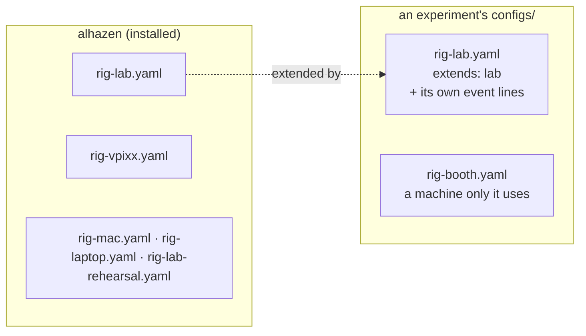
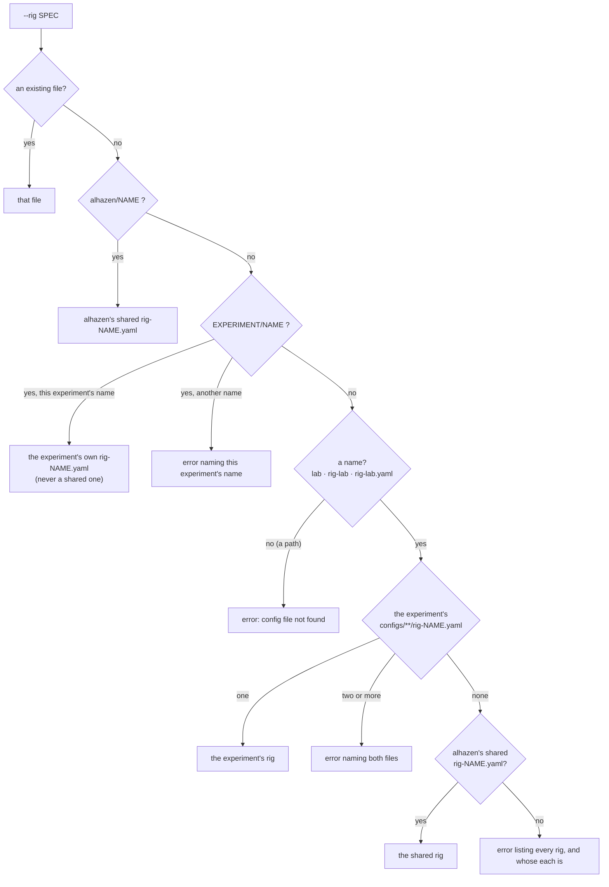
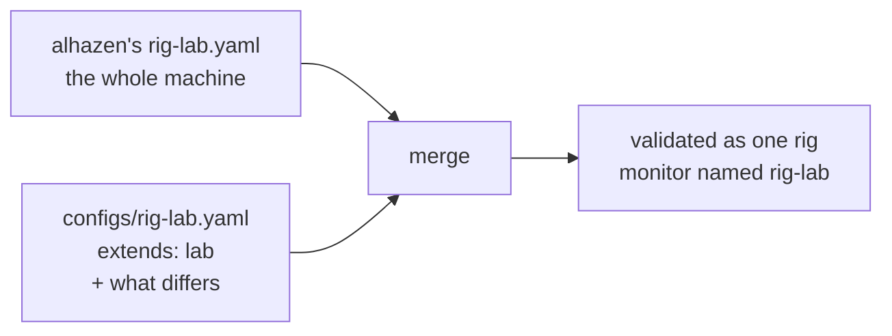
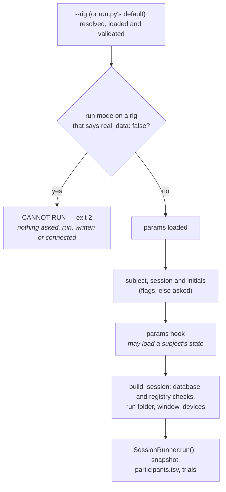
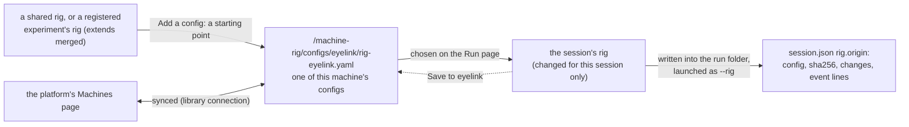

# Rigs

*What a rig file is, the rigs alhazen ships for every experiment to share,
how `--rig` finds one by name, and how an experiment builds its own rig on a
shared one.*

## 1. What a rig is

A **rig** is one YAML file describing one machine: its monitor (size, distance,
refresh rate), its display backend, its devices (eye tracker, reward line,
sync lines), whether the live monitor opens, and where its data goes. It says
nothing about what you are about to do on the machine — that is the
[mode](modes.md)'s business — so every mode takes every rig as it stands. The
one thing a rig does say is whether real data may be collected on it at all:
run mode refuses a development rig (§5).

A rig file is named `rig-<name>.yaml` (or `.yml`), and **the rig is called
`<name>`**: `rig-lab.yaml` is the rig `lab`.

Several experiments run on the same few machines. Each used to keep its own
copy of every one of them, and the copies drifted apart. So alhazen ships the
machines they share, and an experiment keeps only what is its own:



## 2. The shared rigs

They live in alhazen's installation (`alhazen/rigs/`), were taken from the
reference experiment's (amodal-averaging's) own files, and keep those files'
comments on why each setting is what it is.

| Name | Machine | For | Real data |
|---|---|---|---|
| `lab` | EyeLink 1000 on its own Host PC, a solenoid and four TTL lines on an NI DAQ, a photodiode corner | real sessions whose events a neural recording is aligned to; a monkey can be run here | collected |
| `lab-rehearsal` | none: `lab` with every device stood down to a simulated one | rehearsing the lab's checkout (`alhazen check-rig --rig lab-rehearsal --pulse`) and whole sessions away from the rig | refused |
| `vpixx` | the VPixx booth: VIEWPixx panel, TRACKPixx3 in the chassis, a syringe pump gated from the DATAPixx3 ([DATAPixx3 reward](datapixx-reward.md)), no sync | real sessions with human volunteers, who never open the reward line; a monkey can be run here | collected |
| `laptop` | the development laptop (Windows 11, its own 2560×1440 panel at 165 Hz, never the ultrawide beside it), no devices | writing and trying an experiment | refused |
| `mac` | a MacBook Pro 14", no devices | the same, on a Mac; replace its monitor numbers with yours (§4) | refused |

The last column is each file's `real_data:` line: run mode, the one mode that
records real data, refuses the three development rigs before anything is
written, and an experiment can still collect on one of those machines on
purpose (§5).

A shared rig names **no events**. The sync lines and the photodiode mark
events that a *task* declares, and a session refuses a rig naming an event its
task never declares (a pulse for an event that never fires is a TTL silently
missing from the recording). So as shipped, `lab`'s four sync lines pulse
nothing and its photodiode patch never flashes; an experiment adds its own
event names by extending it (§4). The EDF file name and a calibration limit
tighter than alhazen's 1.0° default are left to each experiment for the same
reason.

## 3. Naming a rig

Everything that takes `--rig` — `alhazen run`, an experiment's `run.py`,
`validate`, `check-rig`, `calibrate`, `monitor` — takes a **name** or a
**path**:

```bash
python run.py --task my-task --mode test --rig lab --sub dev --ses 1   # a name
alhazen check-rig --rig configs/rig-lab.yaml --pulse                  # a path still works
```

`lab`, `rig-lab` and `rig-lab.yaml` all mean the rig named `lab`. A path to a
file that exists always means exactly that file, as it did before names.
Otherwise the name is looked up in this order:



- **The experiment's own rig comes first.** An experiment rig *shadows*
  (hides) a shared rig of the same name: `--rig lab` is the experiment's lab.
  `--rig alhazen/lab` always means the shared one.
- **A name can say whose rig it is.** `alhazen/<name>` is a shared rig, and
  `<experiment>/<name>` is one of the experiment's own — `<experiment>` being
  its short name, the `[project] name` in its `pyproject.toml` (the folder's
  name when it has none): `--rig amodal-averaging/lab`. That spelling is the
  experiment's own rig and never falls back to a shared one. An experiment
  name that is not the one searched is refused, naming the right one; so is
  the spelling when no experiment folder is found to check it against. The
  experiment workspace and `alhazen rigs` show every rig this way; a bare
  name keeps working exactly as before.
- **Subfolders count.** `configs/rooms/rig-booth.yaml` is `booth`, as the
  workspace has always found rigs.
- **Two of the experiment's files with one name are an error**, naming both —
  whichever were picked, the other would be silently ignored. Rename one, or
  give the path of the one you mean.
- **Which experiment.** With a task — `alhazen run --task`, or an experiment's
  own `run.py` — it is the experiment the task's code belongs to: the folder
  holding its `pyproject.toml`, wherever the command is typed. With no task
  (`validate`, `check-rig`, `calibrate`, `monitor`, `alhazen rigs`, and
  `alhazen run --mode measure`) it is the current folder, as a relative path
  would be. A task installed from a wheel has no folder of its own; the
  current folder stands in.

`run_experiment(default_rig=...)` takes a name too: `default_rig="laptop"`
starts on the experiment's own laptop, else the shared one. It is what the
run.py `alhazen new` writes passes.

## 4. Extending a shared rig

An experiment rig may begin with `extends: <name>`, naming a shared rig, and
then say only what it does differently. The reference experiment's lab rig,
which used to be a whole file of its own, becomes:

```yaml
# configs/rig-lab.yaml — the shared lab, with this experiment's events and
# its tighter calibration limit.
extends: lab
display:
  photodiode:
    events: [STIM_ON]          # the patch flashes on stimulus onset
devices:
  eyetracker:
    edf_host_filename: amodal.EDF
    accuracy_max_deg: 0.5      # landing position is the dependent measure
  sync:
    event_lines:
      STIM_ON: Dev1/port0/line0
      GO_CUE: Dev1/port0/line1
      SACCADE_ONSET: Dev1/port0/line2
      LANDED: Dev1/port0/line3
```

Everything it does not mention — the monitor, the frame QA policy, the
reward line, the photodiode's corner — is the shared lab's.



How the two files merge:

| In the experiment's file | Effect |
|---|---|
| a section (a mapping), e.g. `devices: {eyetracker: {...}}` | merged key by key into the shared rig's section, down to the leaves |
| any other value: a number, a string, a list | replaces the shared rig's value; a list is replaced whole, not appended to |
| `null`, e.g. `devices: {reward: null}` | removes what the shared rig has there |
| an empty section, e.g. `devices: {}` | **refused**: in a whole file it means "none of these", but merged it would keep everything the shared rig has — the opposite, silently. Write the nulls instead |

The rules around it, each refused with the file named when broken:

- **Only a shared rig can be extended** — `lab` or `alhazen/lab`, never
  another of the experiment's rigs — so what a rig builds on is one file, the
  same wherever alhazen is installed.
- **A shared rig extends nothing**, so there is never a chain to follow.
- **The merged rig is validated** as a whole, and an error in it names both
  files. A typo in the experiment's file is still a typo.
- **The monitor is named after the experiment's file**
  (`configs/rig-booth.yaml` extending `lab` registers with PsychoPy as
  `rig-booth`), unless either file sets `monitor.name`.

Another monitor on the same kind of machine is an override too: a Mac other
than the shared one is `extends: mac` with a `monitor:` section of its own.

## 5. Real data only on a rig meant for it

Every experiment's `run.py` starts on the rig `laptop` when a command names no
`--rig`. Run mode drives a rig exactly as written, and the shared laptop has
no eye tracker, so a forgotten `--rig` used to open a fullscreen window, file
a run under the real `data/v<version>/`, register the subject, and get no
gaze — a gaze-contingent task then ends every trial `NO_FIXATION`, which is
re-served, until somebody quits. An experiment whose params hook carries state
across sessions (an adaptive search) also loaded that subject's real state and
saved it again. All of it was junk, filed where the analysis looks for
subjects.

So a rig says whether real data may be collected on it, in one line:

```yaml
real_data: false   # a development rig: run mode refuses it
```

A **development rig** is a rig whose settings say `real_data: false`: a
machine for writing, trying and rehearsing an experiment, not for collecting
its data. alhazen's shared rigs each say which they are:

| Rig | `real_data` | Why |
|---|---|---|
| `lab` | `true` | the lab rig: real tracker, reward and sync lines |
| `vpixx` | `true` | the VPixx booth: real panel, tracker and reward pump |
| `laptop` | `false` | the development laptop: no tracker, a GPU shared with everything else (it drops frames as a matter of course), and a desk at no measured distance |
| `mac` | `false` | the same on a Mac, and its monitor numbers are an example MacBook's, not any measured panel's |
| `lab-rehearsal` | `false` | no machine at all: the lab with every device simulated and no window, so a run here would file a scripted participant's arithmetic as a subject. The lab it rehearses collects |

**The default is `true`.** A rig that does not say may collect, so every
experiment rig written before this — a booth only one experiment uses, a lab
rig written as a whole file — runs exactly as it did. **A rig that extends a
shared one inherits its answer**, like everything else it does not mention
(§4): `extends: laptop` is a development rig, `extends: lab` collects, and a
`real_data:` line in the experiment's file overrides either. The scaffold
(`alhazen new`) writes `real_data: false` into the Mac rig it generates and
`real_data: true` into its lab rig.

### What is refused, and when

Only run mode records real data (`Mode.writes_real_data`), so only run mode is
refused. Measure, demo, movie, simulate and test take a development rig as
they always have: test and simulate are what a development rig is for, and
their data goes to the rehearsal root.

The refusal comes as soon as the rig is read, before anything else a session
does:



So a refused session leaves nothing: no prompt to answer, no params hook run,
no run folder, no `participants.tsv` row, no database row, no subject state,
no window, no tracker connection. `build_mode_session` makes the same check
(a `ConfigError`) for code that starts a run-mode session itself, and the
experiment workspace makes it before a launch (§10).

The refusal names the rig, says it is a development rig, and says what to
type instead — the experiment's rigs that do collect, found the way
`alhazen rigs` finds them:

```text
CANNOT RUN: run mode records real data, and alhazen/laptop (alhazen's shared rig) is a development rig: its settings say `real_data: false`. Nothing was started and nothing was written.
  No --rig was given, so run.py started on its default rig.
  To record a subject, name the machine it sits at: --rig lab or --rig vpixx (the rigs here that collect real data).
  To try the session on this machine, use --mode test or --mode simulate; their data goes to the rehearsal root.
  To record real data on this machine on purpose, give the experiment its own configs/rig-laptop.yaml saying `extends: laptop` and `real_data: true` (docs/rigs.md §5).
```

### Collecting on a development machine, on purpose

A real pilot on the laptop — a keyboard-only task, say — is still possible,
and is said where it is recorded: the experiment's own rig file.

```yaml
# configs/rig-laptop.yaml — the keyboard pilot of October 2026 runs on the
# development laptop on purpose: real data, no tracker.
extends: laptop
real_data: true
```

`--rig laptop`, and run.py's default, find the experiment's own laptop before
the shared one (§3), so nothing else changes. Because the exception is a
file, it is version-controlled, says why in its own comment, and is part of
every run it records: the run folder's `rig-source.yaml` is the file as
written, its `rig.yaml` the complete rig, and the snapshot's `config.rig`
carries `real_data: true`. There is deliberately no command-line flag for it: a flag
leaves nothing in the repository, has to be typed again at every session, and
is exactly the kind of thing a person in a hurry types to make an error go
away.

### Nothing is written before a refusal

The same promise holds for every check that can refuse a real session at its
start, not only this one. Most of them run before the run folder exists; a
few can only run once the window is open or a device is connected, after the
folder was made. Those leave nothing either: the build **removes what it
created**. `SessionPaths.create` notes the folders it made — the run folder,
its `figures`, and each level above that did not exist yet (`ses-…`,
`sub-…`, `v…`, even the data root) — and a build that fails removes them
again, deepest first, as does a session that is refused at its start before
its snapshot is written. Only folders it made itself, and only while they
hold nothing it did not make: a level that holds another run is left, and
alhazen never deletes a file. The data root is then exactly as it was, and
the run number is not spent (`next_run` counts folders).

Moving the folder's creation after those checks instead was weighed and
rejected: the runner's own check at the start (below) comes after the build
however late the folder is made, and "release what you acquired" is already
how the build treats the window and every device.

The one file a build used to write, the recording pointer
(`recording_pointer.yaml`), is now written right after the snapshot, so the
build itself writes no file at all.

| Refusal | Where | Before | Now |
|---|---|---|---|
| run mode on a development rig | the command line, before params | (new) | nothing written |
| a flag the mode refuses, a missing `--task`/`--sub`, an invalid rig or params file | the command line | nothing written | nothing written |
| no version to file under, a database from a newer alhazen, other initials for the subject, mid-trial reward with no dispenser, a simulated clock on a real display | `build_session`, before the run folder | nothing written | nothing written |
| the window refused (a framebuffer that is not the rig's size, Windows display scaling), a refresh rate that disagrees, a rig naming an event the task does not declare, a tracker or spike source that will not connect, a scheduler that refuses, `validate_after_break` with no tracker | `build_session`, after the run folder | an empty run folder, its number spent (with the pointer in it on a rig with a recorder, which then refused the number outright) | removed |
| another session registered the subject with other initials since the build; the snapshot cannot be written | `SessionRunner.run()`, before the snapshot | an empty run folder | removed |

An older database moved aside by `check_schema` is a migration, not a
refusal's leftover: it is kept, renamed, whatever happens next.

## 6. Listing them: `alhazen rigs`

```text
$ alhazen rigs
rigs for C:\projects\amodal-averaging (experiment amodal-averaging) — give --rig a NAME, with or without its owner, or the path to a rig file

  NAME                   SOURCE      FILE                    NOTE
  amodal-averaging/lab   experiment  configs/rig-lab.yaml    extends alhazen/lab
  alhazen/lab            alhazen     rig-lab.yaml            shadowed by the experiment's lab (reach this one with --rig alhazen/lab)
  alhazen/lab-rehearsal  alhazen     rig-lab-rehearsal.yaml
  alhazen/laptop         alhazen     rig-laptop.yaml
  alhazen/mac            alhazen     rig-mac.yaml
  alhazen/vpixx          alhazen     rig-vpixx.yaml

alhazen's shared rigs (alhazen 2.0.0) are in ...\site-packages\alhazen\rigs
```

Each rig is listed by its qualified name, owner first, which `--rig` takes
as it is (`--rig amodal-averaging/lab`); the bare name (`--rig lab`) means
the same rig. When the experiment's `pyproject.toml` cannot be read, the
folder's name stands in and a note on stderr says why.

`--project PATH` lists another experiment's. It exits 1 when a rig there would
be refused by name — a file that cannot be read, or two files sharing a name —
so a pre-session script can stop on it.

## 7. What a session records

The config snapshot's `sources` records the rig's **file** under `rig`, as it
always has, and beside it the rig's `rig_name` and its `rig_source`
(`experiment` or `alhazen`). The snapshot's `config.rig` is the merged rig, so
a session that ran on an extending rig is fully described without either file.

## 8. Calibrations and measurements of a shared rig

`alhazen calibrate gamma` keeps its fit beside the rig's file, because the
rig reads it back as part of itself. A shared rig's file is inside alhazen's
installation, which a reinstall replaces, so for one of those the fit is kept
where the experiment's own file of that name would be —
`configs/rig-lab_gamma.yaml` — and found there again by the shared rig, and
by an experiment rig of that name if one is added later. Run from a folder
with no `configs/`, it refuses before fitting anything.

Measure mode's reports are data, not configuration: a reading of the machine
as it was that day. They go under the rig's data root,
`<data_root>/measurements/rig-<name>_<stamp>.json`, shared rig or not, beside
the calibration ledger and out of the repository with the rest of the data
([measure-rig.md](measure-rig.md)).

## 9. Moving an experiment onto the shared rigs

1. Delete a rig file that is identical to the shared one (`rig-laptop.yaml`,
   `rig-mac.yaml` in several experiments): `--rig laptop` then finds the
   shared rig.
2. Replace a rig that differs from a shared one in a few places with
   `extends:` and those places (§4). `alhazen validate --rig lab` shows the
   result loads, and `alhazen rigs` shows what extends what.
3. Keep whole files for machines only this experiment uses.

## 10. In the dashboard: this machine's rig configs

The [experiment workspace](workspace.md) runs on one machine, and every
session it launches runs on **one of that machine's rig configs**: named,
complete rig files such as `eyelink`, `keyboard` or `monkey-daq`, one of them
the **default**. Which machine a session runs on is decided by where the
dashboard is running; which of its configs, by the chooser on the Run page.
The configs are kept in the workspace's own state folder, never in an
experiment's repository, and can be edited on the dashboard and on your
[Experiment Platform](experiment-platform/design.md#8a-rigs-the-dashboards-library),
which keep them in sync:

```text
<state>/machine-rig/
  configs.json                 the index: each config's id and name, the default,
                               this machine's id, and the sync state
  rig-<first>.yaml             the first config, where alhazen 3.5.0 kept its
  rig-<first>_gamma.yaml,      single machine rig (with its gamma, reward
  rig-<first>.reward.yaml,     calibration, machine.json and history/)
  machine.json, history/
  configs/<name>/
    rig-<name>.yaml            every other config: no extends, no event names
    rig-<name>_gamma.yaml      a measured gamma (alhazen calibrate gamma), when there is one
    rig-<name>.reward.yaml     the reward calibration (Measure rig, Juice per pulse)
    config.json                where it came from, and every save
    history/                   every earlier version of the file
  trash/<name>.<time>/         a deleted config, moved here, never destroyed
```

`<state>` is the dashboard's state folder (`~/.alhazen/dashboard`, or
`--state-dir`). Each file is named like any rig (§1), so PsychoPy registers
its monitor as `rig-<name>` and the gamma and reward calibration are found
beside it exactly as they are beside an experiment's file (§8). A state
folder is one **machine**: it gets a random id (`mc_…`) the first time
alhazen 3.6 opens it, which is how the platform tells your machines apart.
Two state folders on one computer (yours, and the one Mana runs its copies
from) are two machines, each with its own configs.



### Adding and editing configs

An experiment's **General** page has **This machine's rig configs**: every
config with its default mark, whether it can run (a config that fails the
checks a launch makes is listed with the reason and cannot be chosen), its
sync state and its last save. **Add a config** asks for a name and what it
starts from — a copy of another config, a rig of any registered experiment,
or one of alhazen's shared rigs. That is the only place the shared and the
experiments' rigs are offered: a config is written out complete, so a file
that extends nothing is copied byte for byte, comments and all, and one that
extends a shared rig is written as the merged settings under a header saying
what it was made from; event names are left out (they are chosen per
session, below). After that a config is edited, not re-derived: **Edit**
shows its settings by section (or as YAML), checks them as a launch would,
and saves only if the file has not changed since it was opened, keeping the
previous one in `history/`; **Rename** renames its file and the gamma and
reward files beside it; **Make default**; **Delete** (asked first; the
default cannot be deleted) moves it to `trash/`; **History** lists its saves
and shows any earlier version. The same from a terminal, before anyone opens
the page:

```bash
alhazen rig init --name lab --from lab                      # alhazen's shared lab
alhazen rig init --name eyelink --from configs/rig-booth.yaml --project ~/projects/amodal-averaging --default
alhazen rig list
alhazen rig show --config eyelink
```

All take `--state-dir`. The first config a machine gets is its default.

**From alhazen 3.5.0.** A 3.5.0 workspace kept one machine rig at the top of
`machine-rig/`. 3.6 makes it the first config, named as it was, and the
default, where it is: nothing is moved or rewritten (its bytes, `history/`,
gamma and reward calibration and `machine.json` stay), and the General page
says so once. A 3.5.0 dashboard on the same state folder afterwards keeps
working: it ignores `configs/` and `configs.json`, sees and runs exactly that
first config whichever is the default, and what it saves to it is picked up
by 3.6 as a change made on this machine. If the first config is deleted in
3.6 and a 3.5.0 dashboard then sets a machine rig up again, 3.6 adopts that
file as a new config. Nothing else an existing workspace holds is moved or
rewritten: `projects.json`, the runs, their records and the people registry
stay as they are, and the history still names each earlier run's rig as it
was launched. An experiment's own rig files stay in its repository and keep
working for `run.py` and `alhazen run` (§3, §4); in the workspace they are
starting points for a new config and a source of event lines (below). Each
experiment's data folders are still found from its own rigs as well as from
each config's `data_root`, so data recorded before (or from the command line)
stays on the Data and History pages.

### On the platform, and keeping the two in sync

When the dashboard is connected to a library ([Your library](workspace.md#your-library)), its
configs also appear on that platform: under **Machines** on a self-hosted
platform (`alhazen platform serve` / `local`), under **My machines** in
Mana. There each config can be read and edited with the same sections and a
YAML view, added (from a copy, or from the starting points this machine
offers), renamed, made the default or deleted, and the measured gamma and
juice per pulse are shown (read only: they are measured on the machine).

The machine's own files are what runs, and they keep working offline. The
platform keeps a copy per machine, and the two are kept in step over the
library connection: when the dashboard reads the library, every few minutes
while it runs, after every change made on it, and on **Sync now**.

- A change made on the dashboard is sent; one made on the platform is taken
  by the machine at its next sync, **after the checks a launch makes**. One
  that fails them is refused: the platform shows it as refused with the
  reason, and the machine keeps running its own version.
- Every change names the version it replaces, so nothing is overwritten that
  the other side has not seen. When both sides changed a config since they
  last agreed, neither is overwritten: both pages show both versions, and the
  person keeps one, on either side.
- A deletion asked on the platform of a config that was changed on the
  machine since is not applied: the machine's version stays.
- A platform without rig configs (alhazen before 3.6), one that cannot be
  reached, or no library at all leaves everything on the machine; the
  General page says which.

The protocol is in
[docs/design/machine-rig-configs.md](design/machine-rig-configs.md).

### What a session can change

The Run page's **Rig** section offers this machine's configs, and only
those: a chooser with the default chosen (or the config the page was opened
for, `?rig=<name>`, which `alhazen dashboard --rig-config <name>` and Mana's
Run use). Changing the config starts the section again from that config.
It shows the rig as the session will run it. Under **Rig settings for this session** every
setting is listed under the Monitor, Display, Eye tracker, Reward, Sync, Live
monitor and Data headings, with the control its value takes, as the task
parameters are; a setting changed for this session is marked and has a reset
button giving the config's value, and **Reset all** puts everything back.
These changes are this session's only. **Save to <config>** (asked first,
listing each change) makes them that config's for every later session of
every experiment; the file is then written from its settings, so its
comments go, and the previous file is kept in `history/`.

Two things a session may not change, each refused before anything is
written:

- **`real_data`** is the machine's (§5). A development machine is a
  development rig for every session on it; set `real_data: true` in the
  machine's rig, with a comment saying why, if subjects are recorded there.
- **Measure rig** measures the chosen config as it is saved and keeps what it
  measures beside it, so it runs the config's file itself, read only, and
  refuses a launch that carries changes.

### Event lines

Which of a task's events go out on which sync line, and which flash the
photodiode, are each experiment's, not the machine's (§2): a machine rig
naming an event one task never declares would refuse every other
experiment's sessions. So the machine's rig names no events — they are left
out at set-up, and the editor refuses them — and the Run page's **Event
lines** table assigns them per session. It lists the task's own events first,
each with its line and a photodiode tick, the events every task has folded
underneath, and says plainly how many events go out on a line and that every
other one pulses nothing. Lines are typed, with the device's own offered (an
NI DAQ's `Dev1/port0/lineN`, a DATAPixx3's `DATAPIXX3/doutN`). The two other
settings each experiment adds on a tracker — the EDF file name and a
calibration limit — sit under it.

Nobody has to edit YAML for this, and nothing pulses or goes missing
silently. A session starts from, in this order:

1. **the last session of the same experiment and task on this config** —
   its event lines, photodiode events, EDF name and calibration limit, as it
   ran with them;
2. else **the experiment's own rig named like the config**
   (`configs/rig-lab.yaml` for the config `lab`), which is where an
   experiment kept them before;
3. else **nothing**: no event goes out on a line, and the table says so.

An event the task does not declare is left out of what is carried, and said.
A launch whose rig names an event the task does not declare is still refused,
now by the workspace before anything is written (the session refuses it too).
The task's events come from its parameter schema (`x-alhazen-events`, read in
the project's interpreter); an alhazen from before that lists only the lines
already assigned, and the session checks the names itself.

### What a session records

A session on one of this machine's configs runs **its own copy**, written into the
workspace's run folder as `rig-<name>.yaml` (with the machine's gamma and
reward calibration beside it) and launched as `--rig <that file>`. An
unchanged rig is the machine's file byte for byte; a changed one is its
settings under a header listing each change. `rig.yaml` beside it is the same
bytes, for the History page. The session copies the file into its data run
folder as it copies any rig (`rig-source.yaml`, `rig.yaml`), and records
where it came from in `session.json`:

```json
"rig": {
  "name": "lab", "source": "experiment", "file": ".../runs/<id>/rig-lab.yaml",
  "origin": {
    "kind": "machine", "machine": "lab", "config": "c3f9a01b2d4",
    "file": "<state>/machine-rig/configs/lab/rig-lab.yaml",
    "sha256": "4bda…",
    "changes": [{"path": "monitor.distance_cm", "machine": 57.0, "session": 60}],
    "events": {"source": {"kind": "last-session", "label": "…"},
               "event_lines": {"FIX_ON": "Dev1/port0/line0"}, "photodiode_events": ["FIX_ON"]},
    "workspace_run": "<id>"
  }
}
```

`rig.origin` is passed with `--rig-origin <run folder>/rig-origin.json` to an
alhazen that takes it (the `rig-origin` capability); an older one runs the
same file and records `origin` as nothing, while the workspace's `run.json`
and `launch.json` say the same either way (`rig: "machine"`, `rig_name`,
`rig_source: "machine"`, `rig_config` (the config's id, since 3.6),
`rig_changes`, `rig_carried`, `rig_events_source`, `machine_rig: {file, sha256}`). The History page shows a session's rig, its
changes and its event lines.

### Rigs named by a client

A launch request that names a rig (`rig`: an experiment's file or
`alhazen/<name>`) still launches it as before (merged, refused on a
development rig in run mode, copied as `rig.yaml`), for a script that drives
the workspace's API. The page never sends one.

### Decisions (2026-10-21, alhazen 3.6)

| Decision | Why |
|---|---|
| Several named configs per machine, one the default; the Run page offers only those | A machine often has more than one set-up (an EyeLink, a keyboard-only one, a monkey's DAQ); picking among alhazen's or an experiment's rigs at each session offered rigs of other machines. |
| Shared and experiment rigs only as starting points for a new config | They are templates of a machine, not this machine; once copied, a config is edited, never re-derived. |
| 3.5.0's machine rig stays where it was, as the first config | Nothing is moved or rewritten, and a 3.5.0 dashboard on the same folder keeps running exactly that config instead of silently finding none. |
| A config has a stable id and a name; renaming renames its files | Sync and run records follow the id; the name is the rig's file name, PsychoPy's monitor name and the session copy's name, so they must agree. |
| The machine's files run, and work offline; the platform keeps a synced copy | A session must never depend on a server being up; the platform is where the person edits from elsewhere. |
| The machine validates every platform edit before taking it, and refuses with the reason | Only the machine's alhazen can check a rig as a launch would; a refused edit never replaces what runs. |
| Compare-and-set on revisions; conflicts keep both versions | Neither side overwrites a change it has not seen; the person decides. |
| Sync over the library connection (machine token or a local platform's token) | One connection per machine, already set up for the library; no new credential. |
| A state folder is a machine (random id), never a host name | Stable across renames and networks, and nothing identifying enters a repository. |
| Calibrations (gamma, juice per pulse) stay on the machine, shown read only on the platform | They are measurements of that hardware, made there. |

### Decisions (2026-10-19)

| Decision | Why |
|---|---|
| One rig per workspace, determined by the machine; no rig menu | The machine a session runs on is where the dashboard runs; a menu offered rigs of other machines, and the rig a session got depended on which experiment's folder held which file. |
| One flat file, no `extends` | The machine is the same for every experiment run on it; a merged pair of files said less plainly what it was, and a change to a shared rig changed it silently. |
| Kept in the workspace's state folder, not a repository | It describes this machine, which a repository shared by several machines cannot; research repositories carry no machine-identifying values. |
| Per-session changes, recorded with the session; saving them to the machine is a separate, confirmed action | A session's changes are its own (a different viewing distance that day); making them every later session's is a decision about the machine. |
| Event names never in the machine's rig; carried per experiment and task | They are each task's; a machine rig naming one would refuse every other experiment's sessions. Carrying them means nobody edits YAML per session, and the table shows what pulses. |
| `real_data` not changeable per session | Whether real data may be collected is a property of the rig (§5), decided where it is version-controlled and commented. |
| Measure rig runs the machine's file | What it measures (gamma, juice per pulse) belongs beside the machine's file, and describes the machine as saved. |
| Named rigs still accepted by the API | Scripts that drive the workspace keep working; `run.py`, `alhazen run` and every experiment repository are unchanged. |

